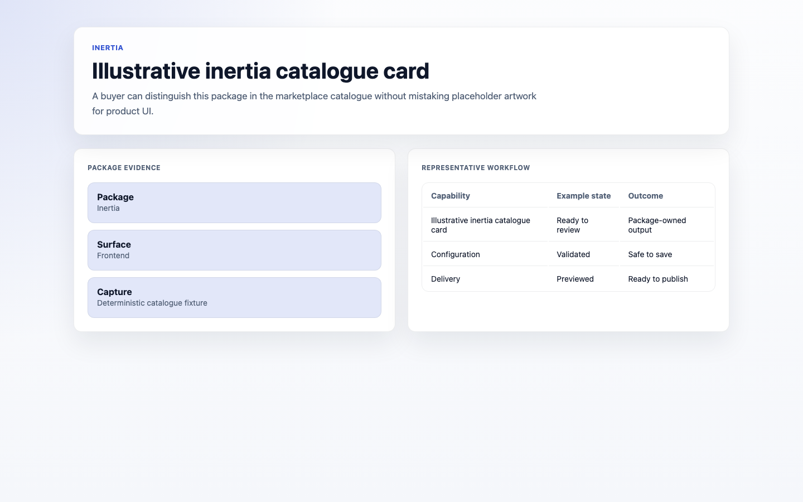

# Capell Inertia

<!-- prettier-ignore-start -->

A development team that builds in Vue or React keeps its JavaScript stack, and Capell pages reach visitors through that front end instead of the site's usual templates. This package sends them there. Editors keep working in the Capell admin and see nothing different.

You pick one adapter to go with it, the Vue adapter or the React adapter. Vue is the default, and a React site sets CAPELL_INERTIA_ADAPTER to react. You also supply a theme set up to show pages through Inertia and you run the front-end build. The package itself contains no JavaScript.

Each page goes to the browser with its title and content, its meta tags, its language and the layout's containers of widgets. Content, image and title widgets each carry a component name for the front end to use, and other widget types carry none. The page shell the front end mounts into must come from a short allowed list of views, and every HTML response is checked for editing leftovers before it leaves. A Diagnostics health check confirms that the page renderer, the request handling and the chosen adapter are registered.

- **Price and availability:** Check current availability and price on the [Capell Marketplace listing](https://capell.app/extensions/inertia).
- **Licence:** Check the licence terms on the [Capell Marketplace listing](https://capell.app/extensions/inertia).
- **Requires:** `PHP ^8.4`, `capell-app/api ^1.0`, `capell-app/core ^1.0.66`, `capell-app/frontend ^1.0`, `inertiajs/inertia-laravel ^3.0`, `lorisleiva/laravel-actions ^2.8`, `spatie/laravel-package-tools ^1.14.1`.
- **Install:** `composer require capell-app/inertia`.

## Quick Start

1. Install the package: `composer require capell-app/inertia`.
2. Verify the package provider and manifest contributions are registered in the host app.

## For Developers

The adapter registry and typed Actions centralize page props, component resolution, and response rendering for Inertia themes.

## Configure

- **Configuration files:** `config/capell-inertia.php`.

## Limits And Pitfalls

- Install the required Capell packages at the versions in `composer.json`: `capell-app/api ^1.0`, `capell-app/core ^1.0.66`, `capell-app/frontend ^1.0`.
- Keep public Blade and cached HTML free of authoring markers, model IDs, permissions, signed editor URLs, and lazy database queries.
- Custom write integrations must preserve invalidation for `inertia` cache tags.

## Screens And Workflow

- Illustrative inertia catalogue card (frontend).

## Install Impact

- Required packages: `capell-app/core`, `capell-app/frontend`, `capell-app/api`.
- Admin navigation: no admin page or resource contribution is declared.
- Admin/editor extensions: none declared.
- Permissions: no package permission declarations or Shield gates detected; host access rules still apply.
- Public routes: none declared.
- Database changes: no package migrations declared.
- Config: `config/capell-inertia.php`.
- Settings: no package settings declared.
- Queues or schedules: none declared.
- Cache tags: `inertia`.
- Commands: none declared.

## Troubleshooting

| Symptom | Likely cause | Check | Fix |
| --- | --- | --- | --- |
| Package surface is missing after install | Provider or manifest is not loaded | Confirm `capell.json`, package `composer.json`, and provider registration | Reinstall the package, refresh Composer autoload, and clear host caches |
| Public output leaks unexpected state | Render data, cache variation, or authoring boundary has regressed | Check public Blade, cache tags, and public-output safety tests | Move data loading out of Blade and rerun the package public-output tests |

## Upgrading

No manual steps between minor versions.

## Next Steps

- [Package docs](docs/README.md)
- [Overview](docs/overview.md)
- Configuration files: [`config/capell-inertia.php`](config/capell-inertia.php).
- [Troubleshooting](#troubleshooting)
- [Developer reference](docs/reference.md)
- [Marketplace assets](docs/assets/marketplace/)
- [Capell content language plan](../../docs/CONTENT_LANGUAGE_PLAN.md)
- [Capell documentation design system](../../docs/DESIGN_SYSTEM.md)
- [Capell and package ERD notes](../../docs/erd/capell-and-package-erds.md)
- Related packages: [API](../api/README.md), [Layout Builder](../layout-builder/README.md).

<!-- prettier-ignore-end -->
